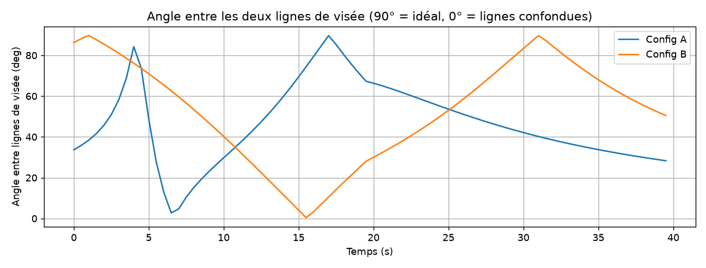
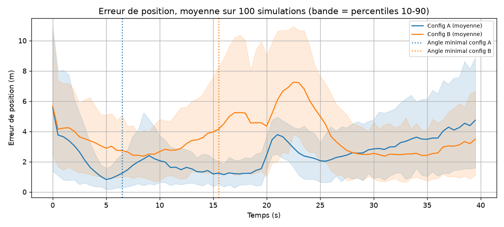
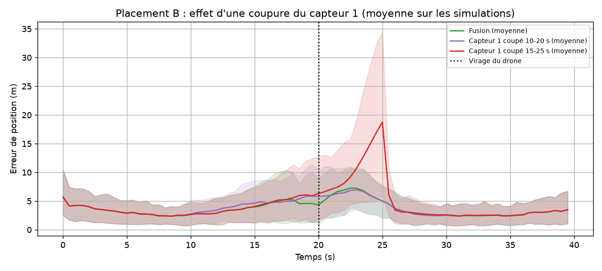
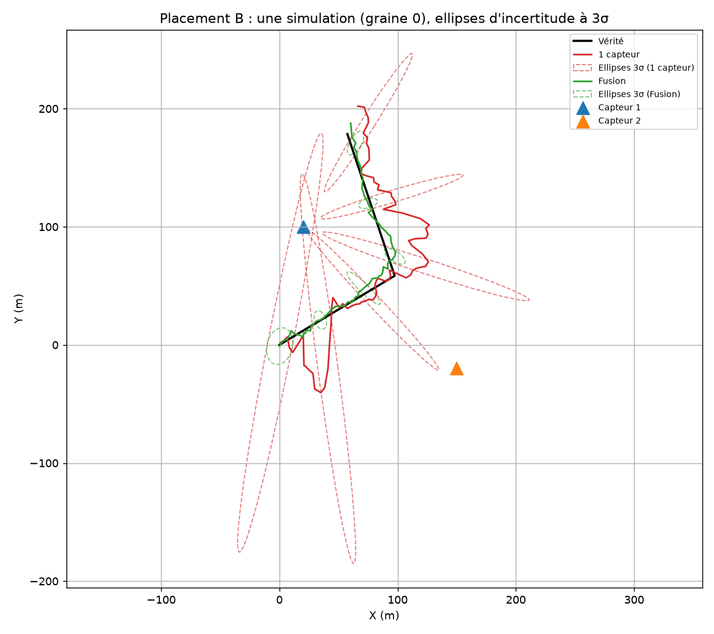

# Résultats

Paramètres : 100 simulations (graines 0 à 99), var_a = 1.0, bruit d'angle = 2.0°, dt = 0.5 s, durée = 40 s, virage du drone à t = 20 s. Erreurs en mètres.

## 1. Géométrie des capteurs

| Placement | Angle min. entre visées | Distance moy. capteur-drone | RMSE 0-10 s | RMSE 10-20 s | RMSE 20-30 s | RMSE 30-40 s | RMSE total |
|---|---|---|---|---|---|---|---|
| Config A | 2.7° (t = 6.5 s) | 79 m | 3.1 | 1.7 | 3.0 | 4.3 | 3.1 |
| Config B | 0.4° (t = 15.5 s) | 107 m | 3.9 | 4.8 | 5.6 | 3.2 | 4.5 |

Capteurs : A = (20, 20) et (100, 20) ; B = (20, 100) et (150, -20).

## 2a. Architectures, placement A

| Cas | RMSE 0-10 s | RMSE 10-20 s | RMSE 20-30 s | RMSE 30-40 s | RMSE total |
|---|---|---|---|---|---|
| Fusion (2 capteurs) | 3.1 | 1.7 | 3.0 | 4.3 | 3.1 |
| Capteur 1 seul | 66.1 | 208.8 | 197.4 | 105.0 | 156.5 |
| Capteur 2 seul | 49.1 | 29.0 | 22.3 | 32.7 | 34.7 |
| Fusion, capteur 1 coupé de 10 à 20 s | 3.1 | 3.7 | 3.4 | 4.3 | 3.6 |
| Fusion, capteur 1 coupé de 15 à 25 s (autour du virage) | 3.1 | 2.2 | 11.1 | 4.3 | 6.3 |

Un capteur d'angle seul : erreur selon la visée (radiale) et perpendiculairement (latérale).

| Cas | RMSE radiale | RMSE latérale |
|---|---|---|
| Capteur 1 seul | 156.2 | 9.7 |
| Capteur 2 seul | 34.6 | 2.4 |

## 2b. Architectures, placement B

| Cas | RMSE 0-10 s | RMSE 10-20 s | RMSE 20-30 s | RMSE 30-40 s | RMSE total |
|---|---|---|---|---|---|
| Fusion (2 capteurs) | 3.9 | 4.8 | 5.6 | 3.2 | 4.5 |
| Capteur 1 seul | 40.2 | 42.8 | 61.6 | 25.8 | 44.5 |
| Capteur 2 seul | 36.3 | 30.2 | 33.8 | 45.3 | 36.8 |
| Fusion, capteur 1 coupé de 10 à 20 s | 3.9 | 5.2 | 5.6 | 3.2 | 4.6 |
| Fusion, capteur 1 coupé de 15 à 25 s (autour du virage) | 3.9 | 5.2 | 10.3 | 3.2 | 6.3 |

Un capteur d'angle seul : erreur selon la visée (radiale) et perpendiculairement (latérale).

| Cas | RMSE radiale | RMSE latérale |
|---|---|---|
| Capteur 1 seul | 44.4 | 2.8 |
| Capteur 2 seul | 36.7 | 2.8 |

## 3. Sensibilité à l'initialisation

Départ « mesures » : construit à partir des premières mesures (défaut). Départ « arbitraire » : (50, 50) m avec une incertitude de 50 m. Départ « exact » : la vraie position (0, 0), irréaliste, donné à titre de référence.

### Placement A

| Cas | RMSE 0-10 s | RMSE 10-20 s | RMSE 20-30 s | RMSE 30-40 s | RMSE total |
|---|---|---|---|---|---|
| Fusion, départ mesures | 3.1 | 1.7 | 3.0 | 4.3 | 3.1 |
| Fusion, départ arbitraire (50, 50) | 672.9 | 1949.5 | 4140.2 | 7040.3 | 4211.9 |
| Fusion, départ exact (0, 0) | 3.1 | 1.7 | 3.0 | 4.3 | 3.1 |
| Capteur 1 seul, départ mesures | 66.1 | 208.8 | 197.4 | 105.0 | 156.5 |
| Capteur 1 seul, départ arbitraire (50, 50) | 302.3 | 819.8 | 1314.7 | 1165.9 | 981.2 |
| Capteur 1 seul, départ exact (0, 0) | 49.3 | 185.8 | 321.9 | 303.3 | 241.1 |

### Placement B

| Cas | RMSE 0-10 s | RMSE 10-20 s | RMSE 20-30 s | RMSE 30-40 s | RMSE total |
|---|---|---|---|---|---|
| Fusion, départ mesures | 3.9 | 4.8 | 5.6 | 3.2 | 4.5 |
| Fusion, départ arbitraire (50, 50) | 10.2 | 4.8 | 5.6 | 3.2 | 6.5 |
| Fusion, départ exact (0, 0) | 3.8 | 4.8 | 5.6 | 3.2 | 4.4 |
| Capteur 1 seul, départ mesures | 40.2 | 42.8 | 61.6 | 25.8 | 44.5 |
| Capteur 1 seul, départ arbitraire (50, 50) | 23.2 | 15.0 | 19.9 | 11.5 | 18.0 |
| Capteur 1 seul, départ exact (0, 0) | 41.8 | 43.9 | 64.3 | 27.4 | 46.3 |

## 4. Exemple d'une simulation (graine 0)

