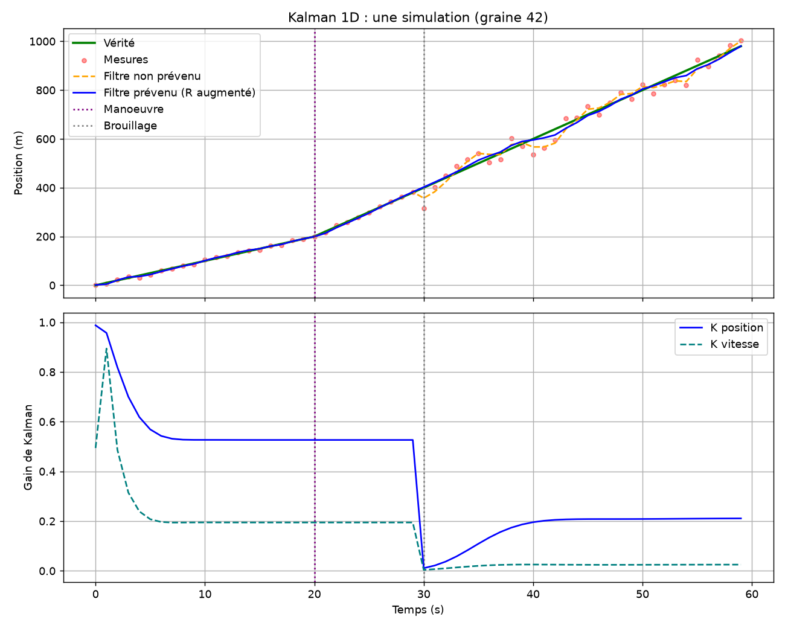
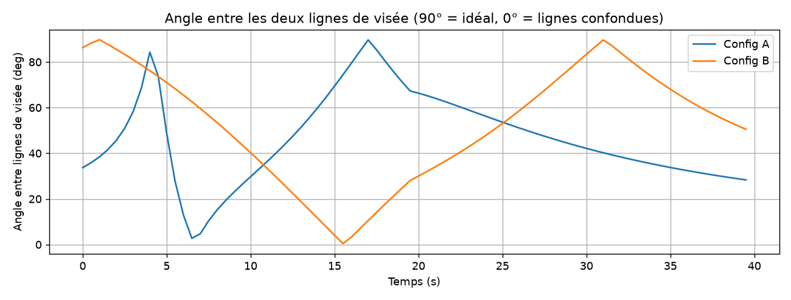
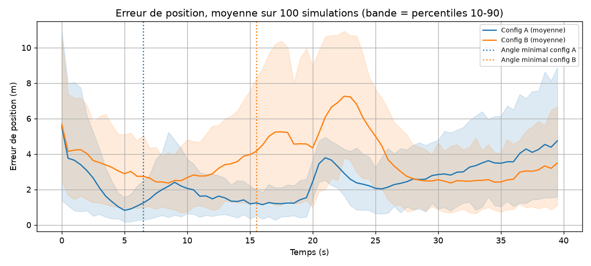
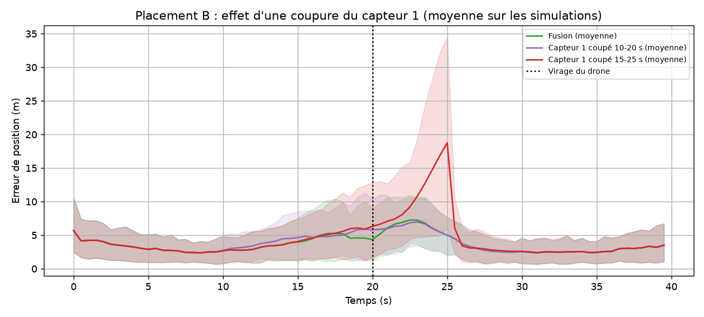
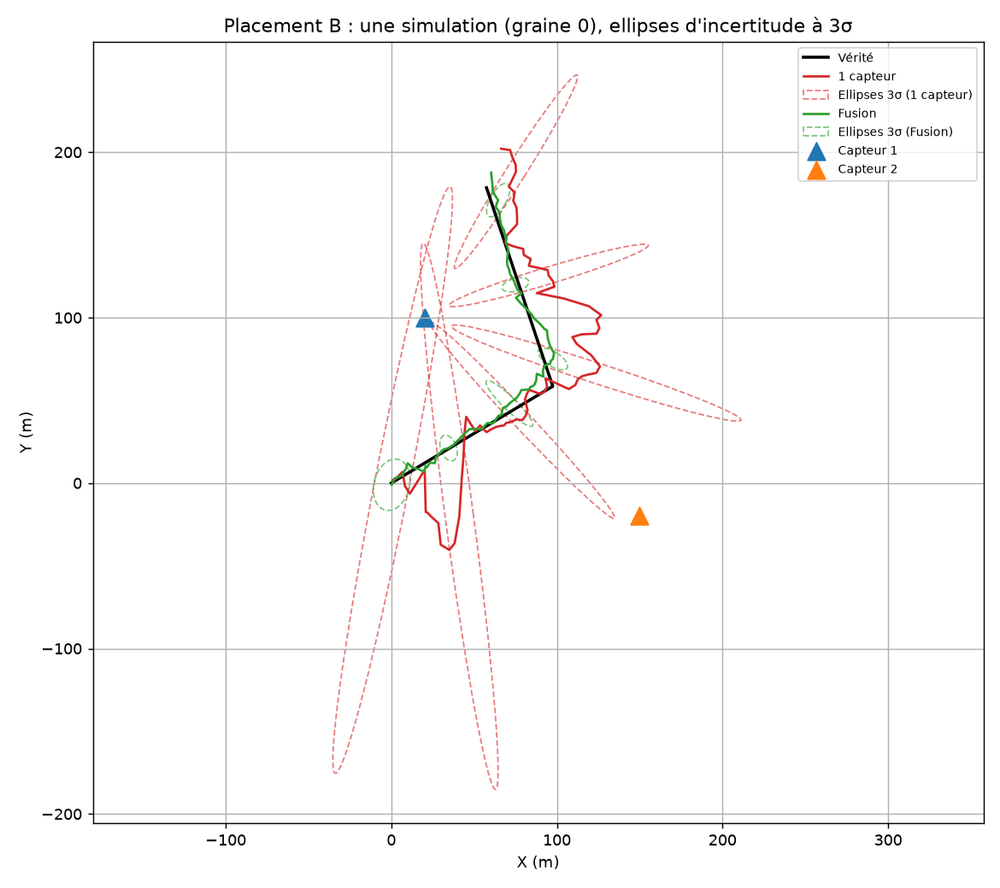

# Fusion de capteurs d'angle pour la détection de drones (EKF)

Étude en simulation : comment localiser un drone à partir de capteurs qui ne mesurent qu'un **angle** (réseau de microphones, caméra), et pourquoi la fusion de plusieurs capteurs change la précision obtenue. Le dépôt va d'un filtre de Kalman linéaire 1D jusqu'à un filtre de Kalman étendu (EKF) 2D à deux capteurs d'angle.

> Il s'agit d'une étude de simulation à visée pédagogique, pas d'un système opérationnel. Les limites sont détaillées en fin de document.

**Résumé.** Étude en simulation (bruit d'angle supposé de 2°, 100 simulations par cas). La fusion de deux capteurs d'angle ramène l'erreur de position à 3,1 m (placement A) et 4,5 m (placement B), contre 34,7 à 156,5 m en A et 36,8 à 44,5 m en B avec un capteur seul. Un point de départ mal placé par rapport à un capteur peut faire diverger le filtre (4212 m en A). Dans ces expériences, l'effet du placement des capteurs n'est pas séparable de celui du virage du drone.

## Contenu

```
drone-detection-fusion/
├── README.md
├── requirements.txt
├── 01_kalman_1d/          Kalman linéaire : suivi 1D avec capteur brouillé
│   ├── kalman_1d.py
│   └── results/
└── 02_ekf_angles_2d/      EKF : suivi 2D avec capteurs d'angle
    ├── ekf.py             modèle, jacobienne, prédiction/correction, initialisation
    ├── simulate.py        trajectoire et mesures bruitées
    ├── metrics.py         RMSE par fenêtre, géométrie des capteurs, erreur radiale/latérale
    ├── plotting.py        figures
    ├── experiments.py     toutes les expériences (100 simulations)
    ├── test_jacobian.py   validation de la jacobienne par différences finies
    ├── test_ekf.py        tests de cohérence du filtre
    └── results/           tableaux (results.md) et figures générés
```

## Reproduire

```bash
pip install -r requirements.txt
python 01_kalman_1d/kalman_1d.py
cd 02_ekf_angles_2d
pytest -v
python experiments.py
```

Toutes les expériences sont déterministes (graines fixées, résultats moyennés sur 100 simulations). Les tableaux chiffrés sont écrits dans `results/results.md` à chaque exécution.

## Partie 1 : filtre de Kalman 1D

**Problème.** Un drone avance à 10 m/s, passe à 20 m/s à t = 20 s, et le capteur de position est brouillé à partir de t = 30 s (bruit multiplié par 10). Deux filtres sont comparés : l'un ignore le brouillage, l'autre en est prévenu en augmentant la variance de mesure R.

**Méthode.** État (position, vitesse), modèle à vitesse constante, bruit de processus par accélération aléatoire, mesure de la position seule.

**Résultats.** Voir `01_kalman_1d/results/results_1d.md` et `kalman_1d.png`. Le RMSE est calculé sur l'ensemble des simulations.



**Interprétation.** *Au brouillage (t = 30 s), l'écart-type de mesure est multiplié par 10, donc la variance R par 100 : le gain de position s'effondre d'environ 0,52 à 0,01, puisque K = P_pred / (P_pred + R). La vitesse est estimée indirectement grâce aux termes hors diagonale de la matrice de covariance P, qui représentent la corrélation entre l'erreur de position et l'erreur de vitesse créée par la matrice de transition F. Sur la figure, le gain de la vitesse s'établit à environ 0,195 (calculé via le ratio 10,28 / 52,81) avant de s'effondrer lors du brouillage. Après ce brouillage, le gain de position remonte vers 0,21, car la covariance de prédiction grossit en l'absence de mesure utile.*

## Partie 2 : EKF 2D avec capteurs d'angle

### Problème

Un capteur d'angle donne une demi-droite sur laquelle se trouve le drone, mais ne donne aucune information sur la distance. Deux capteurs placés à des endroits différents se croisent en un point. Le filtre doit estimer position et vitesse du drone malgré le bruit, en traitant l'angle, qui est une mesure non linéaire de la position.

### Modèle

- État : `X = [x, y, vx, vy]`, modèle à vitesse constante, accélération aléatoire de variance `var_a`.
- Mesure : `theta = atan2(y - ys, x - xs)`, bruit gaussien de 2° d'écart-type.
- Jacobienne : `H = [-(y-ys)/r², (x-xs)/r², 0, 0]` avec `r² = (x-xs)² + (y-ys)²`. Les deux dernières colonnes sont nulles : l'angle ne dépend pas directement de la vitesse.
- Innovation ramenée dans [-π, π], pour éviter la divergence au passage de ±180°.
- Mise à jour séquentielle : les capteurs sont traités l'un après l'autre à chaque instant. Une mesure absente (`NaN`) est simplement ignorée.
- Initialisation à partir des premières mesures (triangulation si les lignes de visée sont suffisamment différentes, sinon un point à distance supposée), jamais à partir de la vérité terrain.

La jacobienne est validée par différences finies centrées en cinq points, pour les deux composantes, y compris près de la coupure à ±π (`test_jacobian.py`).

### Protocole

- Trajectoire : ligne droite, virage brutal à t = 20 s.
- 100 simulations par cas (graines 0 à 99), même bruit pour tous les cas d'une même graine.
- Deux placements de capteurs, A et B, nommés d'après leur position et non d'après leur qualité supposée. Leur qualité est mesurée : angle minimal entre les lignes de visée, distance moyenne, RMSE.
- Expériences : (1) géométrie des capteurs, (2) fusion contre capteur seul et coupures d'un capteur, (3) sensibilité à l'initialisation.

### Résultats

Tableaux complets : `02_ekf_angles_2d/results/results.md`.






**Résultats clés**

- Fusion contre capteur seul : l'erreur de position d'un capteur seul se situe dans une fourchette de 34,7 à 156,5 m dans le placement A, et de 36,8 à 44,5 m dans le placement B, contre respectivement 3,1 m et 4,5 m en fusion. L'erreur de 156,5 m (obtenue avec le capteur 1 du placement A) est presque entièrement radiale, mesurée à 156,2 m contre seulement 9,7 m en latéral. Les valeurs d'un capteur seul dépendent fortement de l'initialisation.
- Géométrie : le placement A obtient le meilleur RMSE total (3,1 contre 4,5 pour le placement B).
- Coupure d'un capteur : l'effet d'une coupure dépend du placement. Dans le placement A, une coupure du capteur 1 de 10 à 20 s fait passer le RMSE de cette fenêtre de 1,7 à 3,7 m, soit plus du double. Pour le placement B, l'effet sur la même fenêtre est faible, passant de 4,8 à 5,2 m. Une coupure de 15 à 25 s, contenant le virage, fait monter le total du placement A à 6,3 m.

### Analyse

1. **Fusion et ellipses.** Les ellipses d'un capteur seul sont très allongées dans la direction radiale (le long de la ligne de visée) car la distance est très mal contrainte par une simple mesure angulaire. Le deuxième capteur apporte une seconde ligne de visée sécante, ce qui permet de trianguler géométriquement la position et de réduire drastiquement cette incertitude.
2. **Géométrie.** Les différences entre A et B peuvent s'expliquer par l'angle entre les lignes de visée et la distance capteur-drone, bien que l'angle minimal seul (2,7° pour A et 0,4° pour B) ne les sépare pas. La figure montre que l'erreur de B monte d'environ 2,4 m vers t = 8 s à environ 5 m vers t = 17 s pendant que l'angle chute. Cependant, la pire fenêtre de B est de 20 à 30 s (RMSE de 5,6 m) et le pic d'erreur se situe vers t = 22 s, après le virage, alors que l'angle est déjà remonté (30° à t = 20 s, 83° à t = 30 s). Le virage et la géométrie sont donc confondus dans cette analyse.
3. **Coupure.** Lors de la coupure du capteur 1 de 15 à 25 s, le capteur 2 reste actif et ne corrige que la composante perpendiculaire à sa visée. Mesurée selon la visée du capteur 2 sur la fenêtre 20-30 s, l'erreur radiale passe de 2,2 à 11,0 m (placement A) et de 4,5 à 9,9 m (placement B), alors que l'erreur latérale ne bouge pas (2,0 → 1,9 m en A ; 3,2 → 3,0 m en B). L'erreur due au virage se concentre donc le long de cette visée (`analyses_complementaires.py`).
4. **Initialisation.** L'initialisation arbitraire en position 50, 50 donne une erreur de 6,5 m en B et de 4212 m en A. Ce qui compte pour le filtre est la position du point de départ par rapport au capteur, et non sa distance à la vérité. Pour le capteur 1 en A, situé en 20, 20, l'angle vers la position arbitraire 50, 50 est de +45°, tandis que l'angle vers la vraie position 0, 0 est de -135°. L'écart entre les deux est de 180°, ce qui fait tomber l'innovation à ±π. En conséquence, le signe de l'innovation dépend uniquement du bruit, rendant la linéarisation de l'EKF caduque. 

   Pour un capteur seul, l'erreur dépend de la profondeur choisie au départ. Placement B, capteur 1 seul, départ sur la ligne de visée à la distance r0 (distance vraie : 102 m) :

   | r0 (m) | RMSE total (m) | RMSE radiale (m) | RMSE latérale (m) | Erreur radiale moyenne signée (m) |
   |---|---|---|---|---|
   | 30 | 29,9 | 29,8 | 1,6 | -16,9 |
   | 60 | 26,3 | 26,2 | 2,1 | +5,8 |
   | 100 | 44,5 | 44,4 | 2,8 | +33,3 |
   | 150 | 72,4 | 72,3 | 3,6 | +64,0 |
   | 200 | 100,7 | 100,6 | 4,3 | +91,7 |

   L'erreur latérale reste faible, car la direction de visée est observable. L'erreur radiale domine, et le RMSE d'un capteur seul mesure donc l'a priori sur la distance, pas la qualité du filtre.

## Limites

- Simulation uniquement : aucune donnée réelle, bruit gaussien et indépendant, capteurs parfaitement synchronisés et positions connues exactement.
- Une seule cible, aucune fausse alarme ni association de mesures.
- Modèle de mouvement à vitesse constante ; `var_a` est réglé à la main et n'est pas optimisé indépendamment du scénario testé.
- L'écart-type de 2° est une hypothèse, pas la précision mesurée d'un capteur réel.
- La linéarisation de l'EKF suppose une estimation initiale raisonnable ; la divergence observée avec un départ arbitraire dans le placement A en est l'illustration.
- Les placements A et B sont deux cas, pas une étude d'optimisation du placement.
- Trajectoire unique ; aucune étude de robustesse à d'autres trajectoires.
- L'effet d'une coupure du capteur 1 de 10 à 20 s dépend du placement (RMSE de la fenêtre ×2,2 en A, ×1,1 en B) ; ce travail ne l'explique pas.
- Les valeurs d'un capteur seul ne sont pas comparables entre elles : elles reflètent l'initialisation.

## Pistes

Optimiser le placement des capteurs, comparer l'EKF à un filtre sans parfum (UKF), vérifier la cohérence statistique du filtre (NEES/NIS), ajouter des fausses alarmes et un seuil de validation des mesures, passer en 3D, puis brancher des mesures acoustiques réelles.